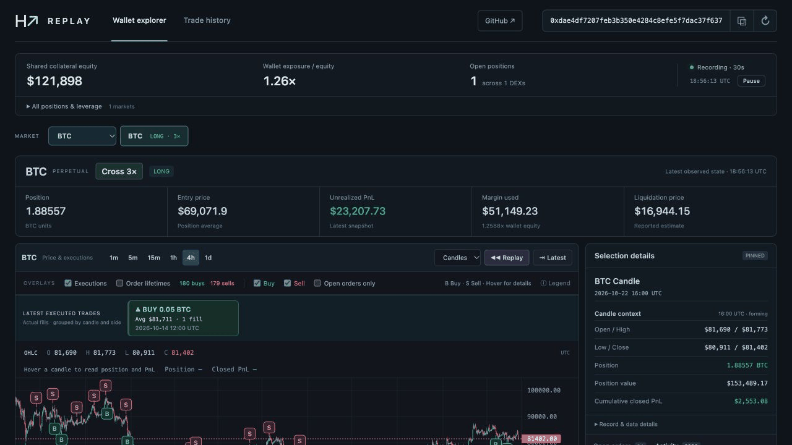

# Hyperliquid Replay

Explore a wallet’s trades on a chart, replay its activity, and browse its trade history. No wallet connection or keys needed.

[Try it online](https://hyperliquid-wallet-replay.modestbox18.chatgpt.site) — free hosted version; no install required.



## Start

Install **Node.js 24+**, **npm**, and **Make**, then run from the project folder:

```sh
make start
```

Open **[localhost:3001](http://127.0.0.1:3001/)**. Keep the terminal running; press **Ctrl+C** to stop. Stop any existing instance before starting another.

## Use

1. Click the address in the top-right corner to load a wallet.
2. Choose a token to see its chart and Buy/Sell markers.
3. Click **Replay** to follow trades, or click a marker or activity item to inspect it.
4. Open **Trade history** to browse executed trades and filter by token.

## Notes

- History is limited to the data returned by Hyperliquid—up to 2,000 recent fills per sync, not the wallet’s complete lifetime history.
- Order placements and historical positions can be reconstructed estimates. Current account metrics are separate from the replay cursor.
- Local: account recording runs while the server is running; saved data stays in `data/`.
- Online: snapshots update while the page is open; saved history stays in your browser.

For development: `make dev` starts live reload, `make test` runs tests, and `make help` lists commands.

[Technical details](docs/TECHNICAL.md) · [Project plan](docs/PLAN.md) · [Hyperliquid API](https://hyperliquid.gitbook.io/hyperliquid-docs/for-developers/api/info-endpoint)

Charts by [TradingView Lightweight Charts](https://www.tradingview.com/lightweight-charts/).
